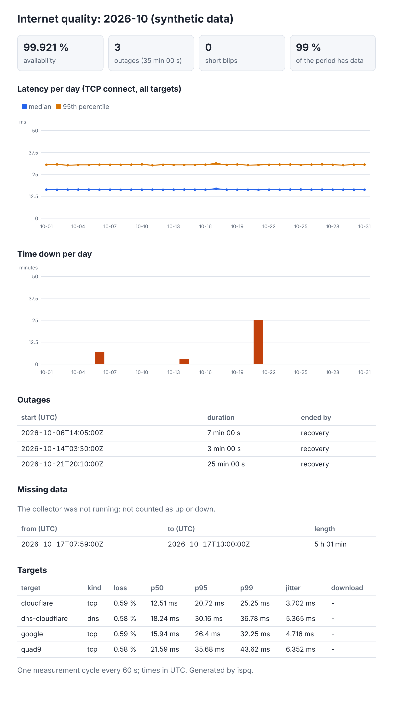

# ispq: internet connection quality tracker

[](https://github.com/TexAlphaWolf/net-isp-quality-tracker/actions/workflows/ci.yml)
[](https://github.com/TexAlphaWolf/net-isp-quality-tracker/actions/workflows/codeql.yml)

Measures latency, jitter, packet loss, DNS time and download speed of an internet connection, keeps every sample in a
SQLite file, finds the outages and writes a monthly report. Standard library only, no root, no agents: one process
and one file. Runs on Windows, Linux and macOS, or in Docker.



## Why

"The internet was down again" is hard to put to a provider without numbers. ispq records, once a minute, how long it
takes to open a connection to a few well-known servers and to resolve a name, and turns the record into: availability,
a list of outages with start and length, latency percentiles per day, loss and jitter per target.

## Quick start

```bash
pip install .                         # or: docker build -t ispq .
ispq init-config                      # writes ispq.toml (public resolvers; edit to taste)
ispq run --config ispq.toml           # measure every minute; Ctrl+C to stop
ispq report --config ispq.toml --month 2026-11 --format html -o report.html
```

Docker (the configuration goes in the volume as `ispq.toml`):

```bash
docker build -t ispq .
docker run -d --name ispq --restart unless-stopped -v ispq-data:/data ispq run --config /data/ispq.toml
docker run --rm -v ispq-data:/data ispq report --config /data/ispq.toml --format html > report.html
```

Other commands: `once` (one cycle, exit code 1 if the connection is down), `outages`, `status`, `purge`,
`export-influx` (InfluxDB line protocol, for Grafana).

## What it measures, and how

| probe | what is timed | needs |
|---|---|---|
| `tcp` | opening a TCP connection (the handshake), several times per cycle | nothing special: no ICMP, no root |
| `dns` | a DNS query answered by a given resolver; only an answer to *that* query from *that* resolver counts | nothing |
| `http` | time to the first byte; optionally the download speed (opt-in, capped, can run every Nth cycle) | nothing |

The definitions that matter are written at the top of `src/ispq/analysis.py` and in [docs/architecture.md](docs/architecture.md):
the connection is **down** when every TCP target failed every attempt (one dead server is not an outage); an
**outage** is at least two such cycles in a row; time in which the collector was **not running** is neither up nor down.

## Measured

All numbers come from `python tools/evaluate.py` ([docs/report.json](docs/report.json), details and caveats in
[docs/evaluation.md](docs/evaluation.md)). There is no real ISP in a test environment, so the truth is injected:
servers on loopback with a known delay, loss and speed, and 200 simulated months with known outages.

- **Outages:** 1110 of 1110 injected outages found, each exactly once; 0 false outages (one dead server and one-cycle blips do not count). Start and length are right to within one measurement cycle.
- **Collector off is not "down":** 72 outages were interrupted by the collector being stopped. Read naively, 62 would have been reported as outages covering time with no data; ispq reports 0. Availability error against the truth: 0.0086 points on average, against 0.5608 when a missing cycle counts as down.
- **Percentiles from every sample:** the 95th percentile of the round-trip times is off by -0.05 %; computed from per-round averages it would be off by -25.24 %.
- **Probes:** DNS and HTTP times are right to within about 2 ms; the lost-query count equals exactly what the server dropped; download speed is within 1.5 % of the offered rate.
- **Cost:** 16.3 MB of database per month (4 targets, one cycle a minute); a month's report takes 1.81 s.

## Configuration

```toml
interval = 60
database = "ispq.db"

[[tcp]]
name = "cloudflare"
host = "1.1.1.1"
port = 443

[[dns]]
name = "dns-cloudflare"
server = "1.1.1.1"
query = "example.com"
```

Keys are validated strictly (a typo is an error). See `examples/ispq.toml`.

## Security

No network service, no privileges. Failures are stored as short fixed reasons, never raw errors or URLs; credentials in
a URL are refused; the HTML report has no scripts and escapes everything. See [SECURITY.md](SECURITY.md).

## Limits

It measures from where it runs, to the targets you choose, with TCP and DNS rather than ICMP. See [docs/limitations.md](docs/limitations.md).

## Development

```bash
pip install -e ".[dev]"
ruff check . && ruff format --check . && mypy && pytest -n auto --cov
python tools/evaluate.py --quick
```

## License

MIT, Luca Tessitore. The screenshot uses synthetic data.
